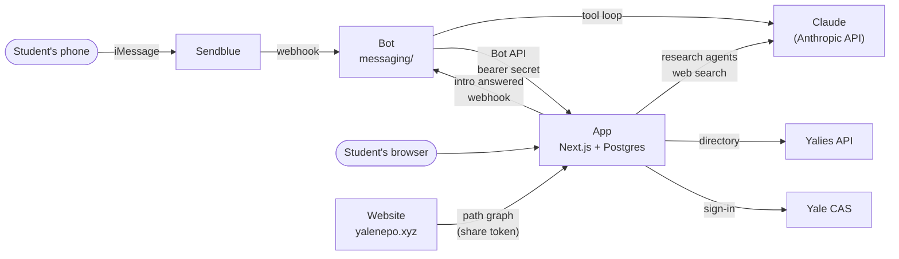
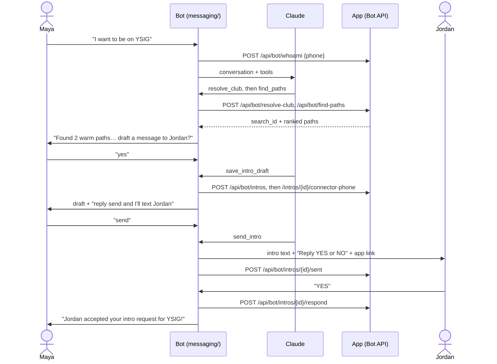

# Yale NEPO — warm intros into Yale clubs

A student texts NEPO: *"I want to be on YSIG."* NEPO works out which of their friends is best placed to
introduce them to someone in that club, drafts the ask, sends it when they say so, and tells them when the
friend answers.

## Demo

▶️ [Watch the demo video](docs/yale-nepo-demo.mp4)

This repository holds all three parts of NEPO:

| Part | Folder | What it is | Owner |
|---|---|---|---|
| **The app** | repo root (`src/`) | Next.js web app and API. Sign-in, friends, clubs, path finding, the intro inbox, and the Bot API. Holds all the data. | Otis |
| **The bot** | `messaging/` | Express server behind the NEPO iMessage number. Talks to the student, using Claude with tools that call the app. | Tobi |

Every model call in the project goes to **Claude** through the Anthropic API: the bot's conversation and
the app's research agents.
| **The website** | `website/` | Static Astro site at [yalenepo.xyz](https://yalenepo.xyz). Explains NEPO and shows a sample path graph. | Arden |

`bot/` is an older Python scaffold (also on Claude now) and is not used. The app's full build spec is
[Grokathon-Otis-App.md](Grokathon-Otis-App.md); section numbers below ("spec 11.3") refer to it.

---

## Contents

1. [How it works, end to end](#1-how-it-works-end-to-end)
2. [Inside the app](#2-inside-the-app)
3. [Inside the bot](#3-inside-the-bot)
4. [How the bot and the app talk](#4-how-the-bot-and-the-app-talk)
5. [Privacy rules](#5-privacy-rules)
6. [Run it locally](#6-run-it-locally)
7. [Deploy (Vercel + Neon)](#7-deploy-vercel--neon)
8. [Code layout and tests](#8-code-layout-and-tests)
9. [Known gaps](#9-known-gaps)
10. [Event, team and docs](#10-event-team-and-docs)

---

## 1. How it works, end to end

### The story

1. **Maya signs in** to the app with her Yale NetID. Her name, college and class year come from the Yale
   directory, so she types nothing.
2. **She links her phone.** The app shows a 6-digit code; she texts it to the NEPO number. From then on,
   the bot knows who is texting.
3. **She adds friends.** She searches the directory for Jordan and Priya and adds them. Jordan accepts.
4. **She adds her clubs**, by pasting her LinkedIn URL, uploading LinkedIn's "Save to PDF" export, or
   typing them in. Background agents check each club against public sources and badge it "Verified",
   "Likely" or "Self-reported".
5. **She texts the bot** "I want to be on YSIG". The bot replies with two warm paths: Jordan, her friend,
   is a YSIG analyst; Priya is friends with Sam, who is on the YSIG board.
6. **The bot drafts a message to Jordan.** Maya says "send". The bot texts Jordan from the NEPO number, and
   the intro appears in Jordan's NEPO inbox.
7. **Jordan replies YES** by text, or taps Accept in the app. Maya gets a text: *"Jordan accepted your
   intro request for YSIG! They'll reach out."*

### The moving parts



- **The app decides; the bot talks.** Every fact (who is friends with whom, who is in which club, what
  state an intro is in) lives in the app's database. The bot keeps only the current conversation.
- **One model, two jobs.** The bot uses **Claude** to hold the conversation and call tools. The app uses
  **Claude** with its web search and web fetch tools for background research: reading LinkedIn profiles,
  crawling club rosters and checking claims.
- **Mock mode everywhere.** The app runs without Yalies or Anthropic keys (`MOCK_EXTERNAL=1`), and the bot runs
  without the app (`BACKEND_MODE=mock`, a small fictional graph). Each part can be demoed on its own.

---

## 2. Inside the app

Next.js (App Router), TypeScript, Postgres through Drizzle. One codebase serves the mobile-first UI and
the API. All business logic is in `src/server/` as plain functions; route handlers in `src/app/api/` only
parse, authorise and call them.

### 2.1 Identity

| Piece | How it works |
|---|---|
| **Sign-in** | Yale CAS (`secure.its.yale.edu/cas`). The NetID only ever comes from CAS's `serviceValidate` response, and the session is an encrypted cookie (iron-session). For local work, `DEV_LOGIN_ENABLED=1` adds a "sign in as NetID" box; it is always off in production. |
| **Profile** | On first sign-in, the person's name, college, class year and photo come from the [Yalies](https://yalies.io) directory API. The client drops the phone, address, birthday and friend data Yalies returns before anything is stored. |
| **Phone linking** | `POST /api/me/phone-code` creates a single-use 6-digit code that lasts 10 minutes. Texting it to the NEPO number makes the bot call `POST /api/bot/link-phone`. Texting from the number proves you own it, and a phone belongs to one account at a time. |

### 2.2 The friend graph

You find people through the Yale directory and add them. A friendship is `pending` until the other person
accepts. People who aren't on NEPO yet can still be added; you get an invite link to send them yourself.
Your friend list is visible only to you.

### 2.3 The club graph

The hard part is knowing who is in which club. LinkedIn's API can't return someone's positions, and NEPO
never logs in to LinkedIn or scrapes it (spec 7.1). So memberships come from four sources, each checked by
a Claude agent:

```
 LinkedIn URL ──► profileReader ──┐
                                  ├─► affiliations ─► resolveClub ─► membership (claimed)
 LinkedIn PDF ──► profileExtractor┘                                        │
 typed in by the student ────────────────────────────────────────► membershipValidator
                                                                           │
 rosterCrawler (per club) ──► names ─► matched to directory ─► memberships ◄┘
 personResearcher (per person) ─► affiliations ─► same path as above
```

| Agent | Web search | What it does |
|---|---|---|
| `profileReader` | yes | Tries to read a public LinkedIn page. If LinkedIn blocks it, it says so and the app asks for the PDF instead. |
| `profileExtractor` | no | Reads the text of an uploaded LinkedIn PDF. If the name on the PDF doesn't match the student, nothing is saved until they confirm it's them. The PDF text is discarded afterwards. |
| `membershipValidator` | yes | Checks one claim ("Maya is a YSIG analyst") against the club's site, Yale Connect and campus news. Returns `confirmed`, `likely`, `not_found` or `contradicted`, with evidence URLs. |
| `rosterCrawler` | yes | Finds a club's published board or member list and transcribes it. Names are matched to the directory, so one run can cover twenty people who never signed up. |
| `personResearcher` | yes | Looks up which clubs one directory person publicly belongs to. Runs when you add a non-user as a friend, or when a search finds few paths. |
| `introDrafter` | no | Writes the "can you intro me?" text in the app's Ask sheet. Fast, so it runs inline rather than as a job. |

All agents go through one function, `src/server/claude/runAgent.ts`, which calls the Anthropic Messages
API (`claude-opus-5-5` by default, set with `CLAUDE_MODEL`). Research agents get Claude's server-side
`web_search` and `web_fetch` tools. Each agent must finish by calling a "submit" tool whose arguments are
validated with zod. **Any evidence URL that is not a page Claude actually retrieved or cited in that run is
removed**, and a verdict left with no evidence is downgraded. This is the main defence against invented
sources. Every call is logged in `agent_runs`, and `/admin` shows it.

If Claude's safety classifiers decline a request, the API reruns it on Anthropic's fallback model
(`fallbacks: "default"`); if that also declines, the job fails with the reason. One agent run is capped at
12 minutes.

**Membership statuses** decide what is shown and used:

| Status | Badge | Used in paths? |
|---|---|---|
| `verified` | green "Verified", with a link to the evidence | yes |
| `likely` | amber "Likely" | yes |
| `claimed` | grey "Self-reported" | yes |
| `disputed` | "Couldn't confirm", shown to the owner only | no |
| `unverified`, `rejected` | hidden | no |

Agent work runs as **jobs** in a Postgres-backed queue (`src/server/jobs/`): `linkedin_read`,
`linkedin_pdf`, `validate_membership`, `crawl_roster` and `research_person`. A job is tried up to 3 times
with backoff, duplicates are collapsed, and at most `ENRICH_MAX_JOBS_PER_HOUR` jobs run per hour. A job
whose runner died is put back after 20 minutes, and failed once its 3 attempts are used. A failed crawl or
research job can be queued again after an hour. Jobs run
right after the request that queued them, and the cron `/api/internal/jobs/tick` picks up anything left.

**Rate limits** (searches, friend adds, new clubs, intros, drafts, LinkedIn reads, phone-code guesses) are
counted in Postgres (`rate_limits`, `src/lib/rateLimit.ts`), so a limit holds across every server instance.
Only a hash of each key is stored.

### 2.4 Path finding

`src/server/paths/findPaths.ts`. Given a requester R and a club C (spec 11):

- **1-hop:** a friend F who is a visible member of C. This includes someone R added who hasn't accepted
  yet, but only for R's own search, because R sends that message themselves.
- **2-hop:** a confirmed friend F (who allows it via `share_connections`) with a confirmed friend T who is
  in C.
- **2-hop, shared club:** F and T are both verified members of some other small club (40 or fewer known
  members).
- **Excluded:** hidden people, anyone who turned off `allow_as_connector`, and a connector who declined an
  intro from R for this club in the last 30 days. If R is already in C, the result is empty with
  `already_member`.

**Scoring** (`src/server/paths/score.ts`, all weights in one constant):

```
score = tie × link × confidence × load + affinity          (clamped to 0–1)
```

| Factor | Values |
|---|---|
| tie (R to F) | confirmed friend 1.0, one-sided add 0.6 |
| link, 1-hop | F is board 1.0, member 0.9, alum 0.6 |
| link, 2-hop | 0.6 via a friend (0.35 via a shared club) × T is board 1.0, member 0.8 |
| confidence | verified 1.0, likely 0.8, self-reported 0.7 |
| load | 0.8 if F already has 3+ intros waiting, else 1.0 |
| affinity | +0.03 same college, +0.03 same class year |

*Example:* Jordan is Maya's confirmed friend and a verified YSIG member, in the same college but a
different year: 1.0 × 0.9 × 1.0 × 1.0 + 0.03 = **0.93**.

Each result carries a `why` sentence built from a template, not a model, so it is instant and never wrong
about the facts: *"Jordan is your friend and a YSIG Analyst (confirmed on the club's site)."*

A search is saved (`path_searches`), and if results are thin it queues a roster crawl or friend research.
`pending_research: true` tells the caller to ask again in a minute.

### 2.5 Intros

`src/server/intros/service.ts` is the only code that writes intros.

```
drafted ──► sent ──► accepted ──► completed
   │         │ └───► declined   (requester sees only "not right now")
   │         └─────► cancelled
   ├──► cancelled
   └──► accepted / declined     (the requester sent the text themselves and the connector opened the link)
```

- Each change checks the status it is leaving, so a cancel and an answer arriving together cannot both win.
- **One open ask per person and club.** While a request to a connector is unanswered, a second one for the
  same club is refused. A new draft replaces an older draft.
- **A saved search is a snapshot.** When an intro is drafted, created or sent, and before the connector's
  phone is released, the app checks again that the connector is still listed, still allows being a
  connector, and is still the requester's friend.

- An intro is created from a saved search, so the connector and target always come from the path NEPO
  found, never from the caller's word alone.
- The connector answers in their inbox, at the link `/i/{token}` (they must sign in as themselves), or by
  replying YES/NO to the bot.
- **Declining needs no reason**, and the requester never sees one.
- When the connector answers in the app, the app posts to the bot's webhook (`BOT_WEBHOOK_URL`) so the
  requester still gets a text.

### 2.6 Screens

Mobile-first, with a bottom tab bar: **Home** (club search, recent searches, pending requests), **Friends**,
**Clubs**, **Intros** (incoming and outgoing) and **Me** (phone, LinkedIn, clubs, privacy toggles, delete
account). There is also four-step onboarding, path results with an Ask sheet, `/i/{token}` for connectors,
and `/admin` (job queue, agent runs, roster names to match). It can be installed as a PWA.

---

## 3. Inside the bot

`messaging/` is a small Express server. Sendblue delivers each inbound iMessage to
`POST /webhooks/sendblue?secret=…`; the bot replies through Sendblue's send API.

### 3.1 One message, step by step

`src/agent/handleMessage.ts`, with one message at a time per phone:

1. **Is this a connector answering?** If the last text the bot sent this phone was an intro request, and
   the message is a YES or NO, the bot records the answer with the app and texts the requester. Claude is
   not called. Any other message, or any later text from the bot, closes that window, so "yes" to the bot's
   own question never accepts an intro by accident (`src/agent/connectorAsks.ts`). The window opens only
   once the request text has actually gone out. If two people have asked the same connector, YES/NO answers
   the older request and the bot says whose it was and that another is waiting.
2. **Who is this?** In `http` mode, the bot asks the app (`whoami`). For an unknown phone, a 6-digit
   message links the phone; anything else gets the sign-up link. In `mock` mode, every phone gets Maya's
   demo friends.
3. **Run Claude.** The bot sends the conversation to Claude with five tools and runs a tool loop of at most
   6 model calls, then texts back the reply (markdown stripped, at most three bubbles). The sixth call
   runs with tools off, so the student always gets a reply that matches what was actually done.

### 3.2 The model call

- Model: `claude-opus-5-5` by default (`CLAUDE_MODEL`), with adaptive thinking at effort `low`
  (`CLAUDE_EFFORT`), so texts come back quickly.
- **Refusal fallback:** with `fallbacks: "default"`, if Claude's safety classifiers decline a message, the
  API reruns it on Anthropic's recommended fallback model. If the whole chain declines, the student gets a
  short redirect, and the declined message is dropped from the history so it is not resent.
- **History:** the last ~20 messages per phone, cut only at a message the student typed. Thinking blocks
  that no longer match the trimmed history are dropped by the API (`prefix_mismatch_behavior: "drop_block"`)
  instead of failing the request.
- Tools are declared with `strict: true`, and every tool input is validated again with zod before it runs.

### 3.3 The tools

| Tool | What it does |
|---|---|
| `resolve_club` | Matches "ysig" or "the Dramat" to a club. |
| `get_club_info` | A club's name, category and description. |
| `find_paths` | Ranked paths for the texter, plus why there are none (`no_friends`, `no_connection`, …). |
| `save_intro_draft` | Saves Claude's draft as an intro. Tells Claude whether NEPO can text the connector or the student must send it themselves. |
| `send_intro` | Texts the draft to the connector. |

**Safety checks around sending:**

- `send_intro` works only on a *later* turn than the draft, only for the pending draft, and only if the
  student's whole latest message is "send" or a plain yes ("yes but change the last line" does not count).
  Claude can't send on its own initiative.
- A pending draft lapses after 30 minutes, when a new search runs, or when a newer draft replaces it. An
  intro is texted at most once, even if recording it with the app fails afterwards.
- `save_intro_draft` accepts only connectors from the latest `find_paths` result, for the same club.
- NEPO texts a connector only if they are a NEPO user who linked that phone themselves **and** have
  accepted the requester's friendship. Otherwise the student sends the draft from their own phone, with the
  app link for the connector.
- The tap-to-send link (`/d/{introId}?k=…`, which opens Messages with the draft filled in) works only
  while the intro is a draft and for 24 hours. The `k` token is the requester's phone, encrypted with a key
  derived from `WEBHOOK_SECRET` and tied to that intro, so the link works on any server instance.
- Phone numbers are never passed to Claude.

### 3.4 Other routes

| Route | Purpose | Protected by |
|---|---|---|
| `GET /health` | Liveness | — |
| `POST /webhooks/sendblue` | Inbound texts | `?secret=WEBHOOK_SECRET` |
| `POST /webhooks/app` | The app reports a connector's answer | `Authorization: Bearer BACKEND_API_SECRET` |
| `GET /`, `POST /chat` | Browser test chat (acts as any phone) | `POST /chat` needs `?secret=WEBHOOK_SECRET`; open the page as `/?secret=…` and it passes it along |
| `GET /d/:introId?k=…` | Tap-to-send redirect | draft only, 24 hours, sealed token in http mode |
| `POST /admin/reset` | Clear sessions (and mock intros) between demo runs | `?secret=WEBHOOK_SECRET` |

---

## 4. How the bot and the app talk

With `BACKEND_MODE=http`, `messaging/src/backend/HttpBackend.ts` calls the app's Bot API at `BACKEND_URL`.
Every request carries `Authorization: Bearer {BOT_API_SECRET}` and identifies the texter **by phone**; the
app never accepts a user id from the bot. The phone is always in the JSON body, never in the URL, so it
does not reach access logs.



If Jordan answers in the app instead, the app posts `intro.responded` to the bot's `/webhooks/app`, and the
bot texts Maya the same way.

Every route, with its body and response, is in [docs/api.md](docs/api.md). In short:

| Bot API route | Used for |
|---|---|
| `POST /api/bot/whoami`, `/link-phone` | Who is texting; linking a phone with the app's code |
| `POST /api/bot/resolve-club`, `/club` | Matching a club; club details |
| `POST /api/bot/find-paths` | Ranked paths and a `search_id` |
| `POST /api/bot/intros`, `POST /api/bot/intros/{id}/read`, `POST …/sent` | Save, read and mark an intro sent |
| `POST /api/bot/state/get`, `/state/put`, `/state/claim` | The bot's per-phone state and once-only webhook claims (section 7) |
| `POST /api/bot/intros/{id}/connector-phone` | The connector's phone, only under the rules in 3.3; otherwise `null` |
| `POST /api/bot/intros/{id}/respond` | The connector answered by text |
| `POST /api/bot/intros/list`, `POST /api/bot/draft-intro`, `/friends/add` | Also available (from `docs/bot-tools.json`); the Claude bot doesn't use them yet |

---

## 5. Privacy rules

NEPO stores who knows whom and researches students who haven't signed up, so these rules are requirements
(spec 12). They are tested in `tests/unit/privacy*.test.ts`, `jobs.test.ts` and `regressions.test.ts`.

1. **Yale only.** Every page and API route needs a CAS session, the bot secret or the cron secret. The
   exceptions are sign-in and the token-gated graph endpoint. A test fails the build if a route skips its
   guard.
2. **Minimal data on non-users:** name, college, year, photo, club memberships with evidence. Never their
   major, email, phone or jobs.
3. **Public sources only.** No LinkedIn login, cookies or headless browser.
4. **Evidence or nothing.** A non-user's membership exists only with a cited evidence URL.
5. **Opt-out that sticks.** "Hide me from NEPO" removes you from search, paths, graphs and research.
6. **Friend lists stay private.** A path reveals one friendship at a time, only to that person's friends,
   and only if they allow it.
7. **Nobody is contacted without a decision.** The app never sends a message itself. The bot texts a
   connector only after the requester says "send", and only a connector who linked their own phone and
   accepted the requester's friendship. Non-users are never texted.
8. **Connectors are in control.** Declining is one tap or one word, needs no reason, and shows the
   requester only "not right now".
9. **Uploads are transient.** PDF text is parsed in memory and removed when the job finishes.
10. **Agent inputs are data.** Fetched text is wrapped in tags and treated as content, not instructions.
11. **Logs** contain no phone numbers, PDF text or tokens.
12. **Deletion** works from `/me`.

Before running this beyond a hackathon demo, check the Yalies API terms and Yale's policies on directory data.

---

## 6. Run it locally

### 6.1 The app

Needs Node 22+ and pnpm. No database install and no API keys: by default the app uses an embedded
Postgres (PGlite) in `.data/`, and Yalies and Claude are mocked.

```bash
pnpm install
cp .env.example .env.local     # defaults work as they are
pnpm db:migrate                # create the schema
pnpm db:seed                   # 20 clubs and the demo people
pnpm dev                       # http://localhost:3000
```

Sign in with the development box as `demo_maya` (also `demo_jordan`, `demo_priya`) and search for YSIG:
Jordan is the first path, Priya through Sam the second. Any other NetID in
`tests/fixtures/yalies/people.json` (for example `bo107`) signs in as a new student and goes through
onboarding.

For real data, set `MOCK_EXTERNAL=0` and fill in `YALIES_API_KEY` (then run `pnpm sync:directory` once),
and `ANTHROPIC_API_KEY` (`CLAUDE_MODEL` defaults to `claude-opus-5-5`).

### 6.2 The bot

```bash
cd messaging
cp .env.example .env           # add ANTHROPIC_API_KEY; DRY_RUN is true unless you set it to false
npm install
npm test
npm run dev                    # http://localhost:3001
```

- **Talk to it in a terminal:** `npm run simulate -- +15550000001` (Maya's demo phone).
- **Talk to it in a browser:** open `http://localhost:3001/?secret=<WEBHOOK_SECRET>`.
- With `DRY_RUN=true` (the default), outgoing texts are printed instead of sent.
- The bot refuses to start with `BACKEND_MODE=mock` and `DRY_RUN=false`, because the mock graph would text
  the demo numbers for real. For a staged demo on real phones, set `ALLOW_MOCK_LIVE_SENDS=true` and map
  phones to names with `DEMO_STUDENT_NAMES` and the `DEMO_*_PHONE` variables. No real phone number is kept
  in the repository.
- `messaging/README.md` covers Sendblue, the Cloudflare tunnel and the live demo checklist.

### 6.3 Both together

Run the app on :3000 and the bot on :3001, then in `messaging/.env`:

```
BACKEND_MODE=http
BACKEND_URL=http://localhost:3000
BACKEND_API_SECRET=<the app's BOT_API_SECRET>
SIGNUP_URL=http://localhost:3000/login
```

In the app's `.env.local`, set `BOT_WEBHOOK_URL=http://localhost:3001/webhooks/app`. The seeded demo people
have phones `+12035550101` (Maya), `+12035550102` (Jordan) and `+12035550103` (Priya), so the web chat can
play each of them. `./scripts/bot-smoke.sh` runs the Bot API conversation as plain curl calls.

### 6.4 The website

```bash
cd website && npm install && npm run dev    # http://localhost:4321
```

### 6.5 Commands (app)

| Command | What it does |
|---|---|
| `pnpm dev` | App on :3000 |
| `pnpm db:migrate`, `pnpm db:seed` | Schema; demo data (`--purge` removes every demo person) |
| `pnpm worker` | Job loop for agent jobs |
| `pnpm sync:directory` | Bulk-import Yale College from Yalies |
| `pnpm crawl:clubs` | Queue a roster crawl for every club (`--force` ignores the 14-day TTL) |
| `pnpm gen:bot-tools` | Regenerate `docs/bot-tools.json` and the Bot API section of `docs/api.md` |
| `pnpm test`, `pnpm test:e2e` | Unit/integration tests; Playwright run of the demo |
| `pnpm typecheck`, `pnpm lint`, `pnpm build` | Checks and production build |
| `pnpm db:generate` | Generate a migration after changing `src/server/db/schema.ts` |

While `pnpm dev` holds the embedded database, the scripts automatically run through the dev server instead.

---

## 7. Deploy (Vercel + Neon)

`vercel.json` deploys all three parts as **services in one Vercel project**:

| Requests | Go to |
|---|---|
| `/bot` and `/bot/*` on any host | the bot (`messaging/`), with the `/bot` prefix removed |
| any path on `yalenepo.xyz` / `www.yalenepo.xyz` | the website (`website/`) |
| everything else (e.g. the `*.vercel.app` domain) | the app |

The cron calls `/api/internal/jobs/tick` once a day at 09:00 UTC, because the Hobby plan allows only daily
crons. On a paid plan you can set it back to every minute.

**Steps**

1. Create a Neon database. Run `pnpm db:migrate` (and `pnpm db:seed` for demo data) against it from your
   machine with `DATABASE_URL` set to its `postgres://` URL.
2. In the Vercel project, import the repo with **Root Directory** left at the repo root.
3. Set the environment variables below, then deploy.
4. Point Sendblue's receive webhook at `https://<domain>/bot/webhooks/sendblue?secret=<WEBHOOK_SECRET>`.

| Part | Variables |
|---|---|
| App | `DATABASE_URL` (Neon), `APP_URL` (the app's https origin; Yale CAS redirects back here), `SESSION_SECRET` (32+ random characters), `BOT_API_SECRET`, `CRON_SECRET`, `BOT_PHONE_DISPLAY`, `ADMIN_NETIDS`, `YALIES_API_KEY`, `ANTHROPIC_API_KEY`, optionally `CLAUDE_MODEL`, `MOCK_EXTERNAL=0`, `WEBSITE_ORIGIN=https://yalenepo.xyz`, `BOT_WEBHOOK_URL=https://<domain>/bot/webhooks/app`. Leave `DEV_LOGIN_ENABLED` unset. With `NODE_ENV=production` the app refuses to run on the example secrets from `.env.example`, on secrets that are too short, or with a non-https `APP_URL`. |
| Bot | `ANTHROPIC_API_KEY`, `WEBHOOK_SECRET`, `SENDBLUE_API_KEY_ID`, `SENDBLUE_API_SECRET`, `SENDBLUE_FROM_NUMBER`, `DRY_RUN=false`, `PUBLIC_BASE_URL=https://<domain>/bot`, and for the real app: `BACKEND_MODE=http`, `BACKEND_URL=https://<domain>`, `BACKEND_API_SECRET` (= `BOT_API_SECRET`), `SIGNUP_URL=https://<domain>/login`. Optional: `CLAUDE_MODEL`, `CLAUDE_EFFORT`. |
| Website | `PUBLIC_APP_URL` (the app's origin), optionally `PUBLIC_GRAPH_SHARE_TOKEN`, `PUBLIC_BOT_PHONE`. |

**Check it:** `https://<domain>/bot/health` should return `{"ok":true,…}`. If it returns
`FUNCTION_INVOCATION_FAILED`, the bot crashed at startup, usually because a required variable is missing
(the bot refuses to start without `ANTHROPIC_API_KEY` and `WEBHOOK_SECRET`, and in `http` mode without
`BACKEND_URL`, `BACKEND_API_SECRET` and a real `SIGNUP_URL`). The function's logs in Vercel name the
missing variable.

**The bot on Vercel** (details in `messaging/README.md`):

- With `BACKEND_MODE=http`, the bot keeps nothing between texts in its own memory. Each phone's
  conversation, the draft waiting for "send" and the requests waiting for a YES or NO are saved in the
  app's database (`bot_state`) after every text and loaded before the next, so any instance can take the
  next message and a restart loses nothing. A webhook delivered twice is handled once across instances
  (`bot_claims`). Saved state expires after 24 hours; a conversation idles out after 30 minutes.
- Webhooks are answered after the work is done (the Sendblue webhook waits up to 25 seconds, the app
  webhook up to 10), so the function is not stopped mid-message. Give the function a max duration above 25
  seconds.
- In `mock` mode there is no app to save to, so state stays in the process. Use mock mode on one
  long-running machine only.
- If two texts from the same phone reach two instances at the same moment, the later save wins.

Run `pnpm db:migrate` against the production database when deploying this version: it adds the
`bot_state`, `bot_claims` and `rate_limits` tables.

---

## 8. Code layout and tests

```
src/
  app/(app)/…            signed-in screens          app/api/…   route handlers (thin)
  server/
    api/route.ts         route wrappers: appRoute, botRoute, adminRoute, cronRoute, publicRoute
    auth/  yalies/       CAS, sessions, guards; the directory client
    friends/ memberships/ clubs/ people/
    paths/               findPaths, score (weights), explain (why sentences)
    intros/service.ts    the only writer for intros
    agents/ claude/ jobs/  Claude agents and prompts, runAgent, the job queue
    bot/tools.ts         Bot API request schemas → docs/bot-tools.json
    privacy/             visibility and phone redaction
  components/            UI
messaging/src/
  agent/                 handleMessage (Claude loop), tools, session, connectorAsks, systemPrompt
  backend/               HttpBackend (the app), MockBackend + seed (demo graph)
  transport/             sendblue (in/out), webchat
  app.ts index.ts        routes; entry point (also the Vercel export)
website/src/             Astro pages (/ and /how), the sample graph
drizzle/                 SQL migrations
tests/                   app tests (Vitest, in-memory Postgres, no network) and Playwright e2e
```

| Suite | Command | Covers |
|---|---|---|
| App | `pnpm test` | Path finding and scoring cases (spec 11.6), every privacy rule, memberships, jobs and agents with fixtures, the App and Bot APIs, CAS parsing |
| App e2e | `pnpm test:e2e` | The demo story in a phone-sized browser |
| Bot | `cd messaging && npm test` | The Claude tool loop (with a fake client), the send gate, connector replies, phone linking, the HTTP client against a stand-in app, routes and secrets |

---

## 9. Known gaps

- **Not yet tried with real credentials:** Yale CAS sign-in, the Claude research agents (the app has only run
  in mock mode), the bot against the deployed app, and `sms:` links on a real iPhone. Yalies has been checked
  against the live API.
- **The bot on Vercel** (section 7) has not been run there yet. Its state is now saved in the app's
  database, which has only been exercised locally.
- **Phone numbers used in an earlier demo are still in git history.** They are gone from the code; removing
  them from history needs a history rewrite and a force-push.
- **The bot uses five of the app's bot routes.** Listing intros ("did Jordan reply?") and adding friends by
  text are in the app but not wired into the bot yet.
- **Differences from the spec:**
  - Local development uses embedded PGlite instead of Docker Postgres.
  - Yalies paging is 0-based.
  - Two schema columns were added: `path_searches.share_expires_at` and `users.linkedin_job_id`.
  - A few extra endpoints exist (friend suggestions, admin overview, crawl-all, dev login).
  - Every model call uses Claude (Anthropic API) rather than Grok.
  - The "Connect LinkedIn" badge (P2) was not built.

---

## 10. Event, team and docs

Repo: https://github.com/Otis-IKP/Grokathon
Event: **y/cs x SpaceXSI Grokathon Yale 2026** · Tue Nov 17 · **5:00–9:00 PM** · Tsai CITY
Submissions until **8:00 PM**, awards ~8:45 PM.
Luma: https://luma.com/dis51jq2

| Person | Role |
|--------|------|
| **Tobi** | iMessage bot (`messaging/`, Claude via the Anthropic API). `bot/` is an older scaffold. Do not demo it. |
| **Otis** | App + backend API |
| **Arden** | Website |

**Docs**

- [Grokathon-Otis-App.md](Grokathon-Otis-App.md) — the app's full build spec
- [docs/api.md](docs/api.md) — every App API and Bot API route
- [messaging/README.md](messaging/README.md) — running and presenting the bot (Sendblue, tunnel, checklist)
- [docs/TEAM_HANDOFF.md](docs/TEAM_HANDOFF.md) — what the bot does, and how to change it
- [website/README.md](website/README.md) — the website and its domain setup
- `docs/yale-nepo-hackathon-plan.md` — full plan; `docs/yale-warm-intros-plan.md` — short brief
- `shared/api_contract.md` — the old Python bot's contract (out of date)
- [NEPO bot handoff](https://docs.google.com/document/d/17YLnLekIi-4NvDZzLEvBV5DRbs4_WcV71G8LaDs5AUw/edit) — same note in the shared Drive folder, with the phone map
- Drive folder: https://drive.google.com/drive/folders/1KoXnodnMgJ77r27w7-A_eiJQwqsbWnNg

**Models:** NEPO runs on **Claude** (Anthropic API) throughout. The event's prize rule asked for Grok
models; the project moved to Claude after the event.
